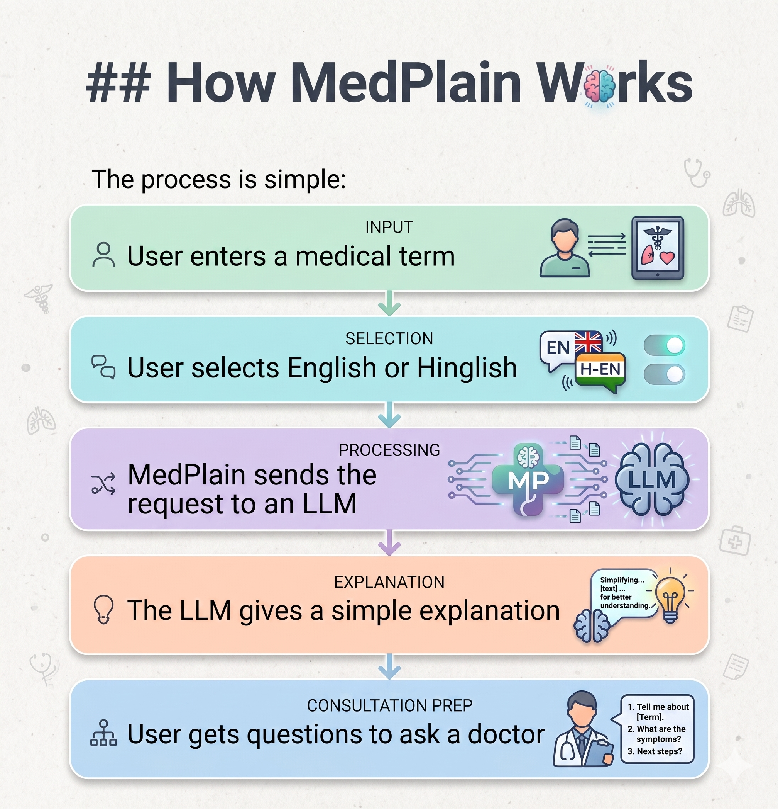

# MedPlain-AI-Medical-Translator
AI-powered medical terminology translator using Python and OpenAI.

## Objective
To help people understand complicated medical words found in medical reports and provide useful questions they can ask their doctor.

## Steps Followed
1. Imported the required Python libraries and connected to the OpenAI API.
2. Loaded the API key securely using a `.env` file.
3. Selected a medical term, such as "Hypertension".
4. Added optional context from a medical report.
5. Created a system prompt to explain terms in simple language and avoid medical advice.
6. Created a user prompt with the medical term, context, and preferred language (English or Hinglish).
7. Sent the prompts to the GPT-5-nano model.
8. Displayed the AI-generated explanation, general meaning, and three questions to ask a doctor.

## How It Works

## Conclusion
MedPlain AI demonstrates how large language models can simplify medical terminology. It provides easy-to-understand explanations in English or Hinglish and helps users prepare questions for their doctors.

**Note:** This project provides general educational information only. It does not diagnose medical conditions or recommend treatments.
